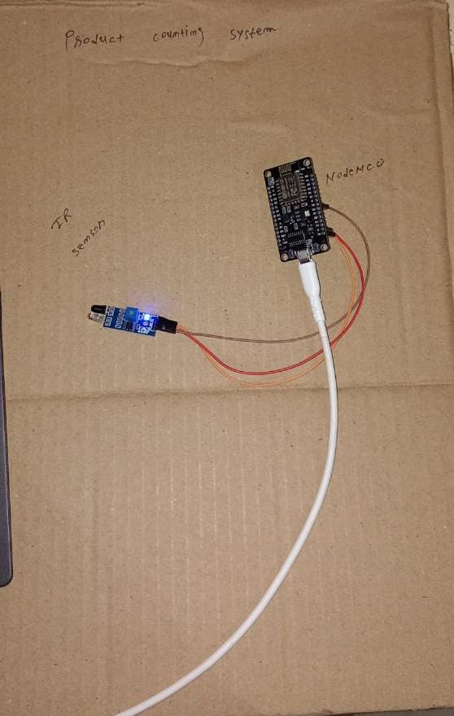
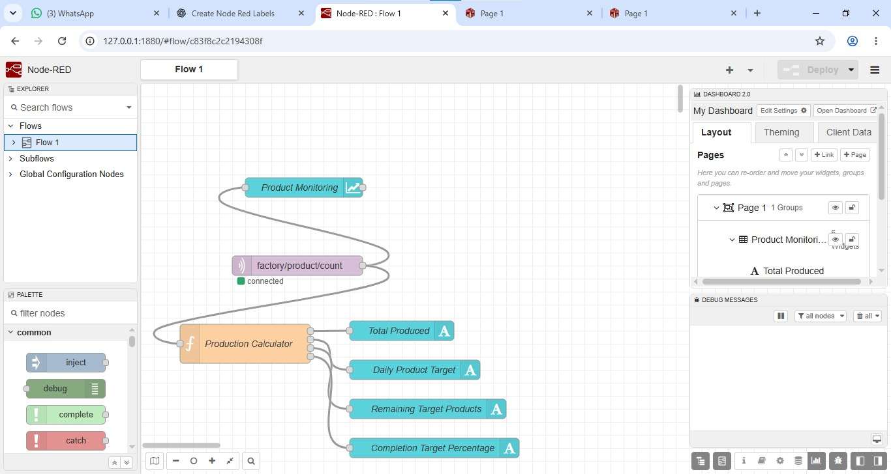
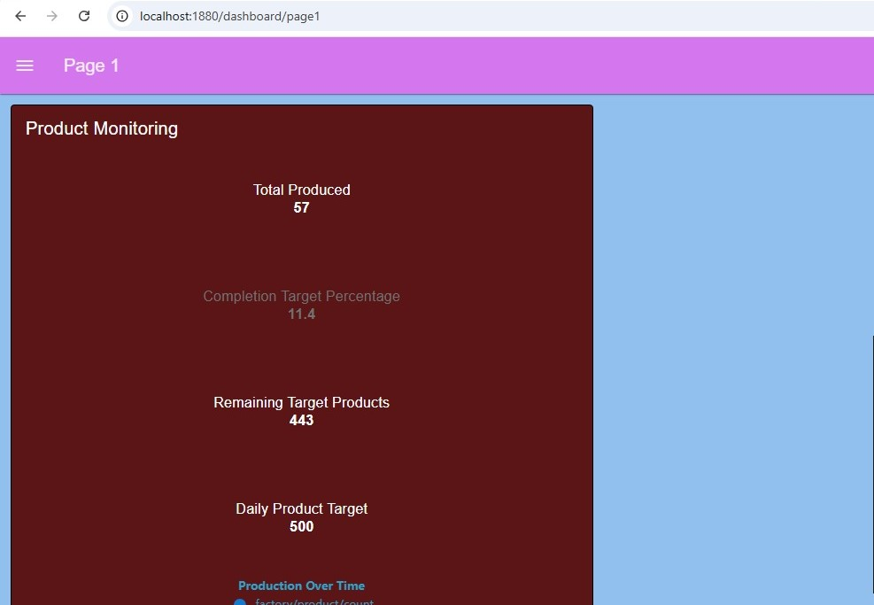
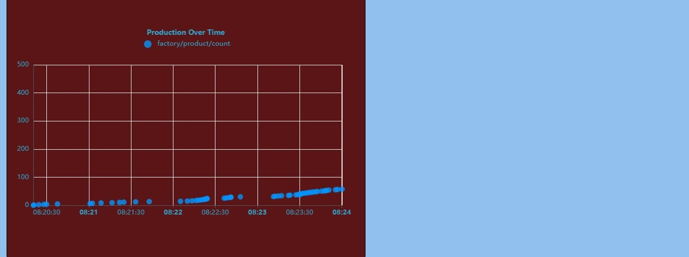

# IoT-Based Product Counting System Using IR Sensor, MQTT and Node-RED

A real-time industrial product counting and telemetry monitoring system built using an **ESP8266 NodeMCU**, an **IR Obstacle Sensor**, the **MQTT communication protocol**, and a **Node-RED Dashboard**. The system automatically detects objects passing along a conveyor or checkpoint, publishes live counts over MQTT, and visualizes production activity in real time.

## Key Features
* **Automated Object Detection:** Uses an infrared (IR) sensor to detect products passing through a designated checkpoint accurately without physical contact.
* **Lightweight MQTT Telemetry:** Publishes real-time product count updates from the ESP8266 NodeMCU to an MQTT broker with low latency.
* **Live Node-RED Dashboard:** Displays real-time product counts, production rate metrics, and visual status gauges on a web-based Node-RED UI.
* **Reset & Monitoring Controls:** Allows operators to track batch totals and reset counts remotely from the dashboard.

## Hardware & Software Components
* **Microcontroller:** ESP8266 NodeMCU
* **Sensor:** IR Proximity / Obstacle Avoidance Sensor Module
* **Protocols & Brokers:** MQTT (Mosquitto / HiveMQ)
* **Dashboard & Software:** Node-RED, Arduino IDE, Embedded C/C++

## How It Works
1. When an item passes in front of the **IR sensor**, the sensor output triggers a signal on the **ESP8266 NodeMCU**.
2. The **NodeMCU** increments the product counter and debounces the signal to prevent double-counting.
3. The updated count is published via **MQTT** to a specific topic over Wi-Fi.
4. **Node-RED** subscribes to the MQTT topic, processes the incoming payload, and updates the live **Node-RED Dashboard** charts and counters in real time.

## Hardware Prototype & Dashboard Preview
The physical ESP8266 + IR sensor setup and the Node-RED telemetry dashboard:

### 1. Hardware Prototype Setup

### 2. Node-RED MQTT Flow Architecture

### 3. Live Product Counter Dashboard – Overview

### 4. Live Product Counter Dashboard – Metrics & Controls

## Repository Structure
* [Product_Counter_MQTT.ino](./Product_Counter_MQTT.ino) – ESP8266 NodeMCU code for IR detection and MQTT publishing
* [hardware_prototype.jpg](./hardware_prototype.jpg) – Photo of the ESP8266 NodeMCU and IR sensor hardware prototype
* [nodered_flow.png](./nodered_flow.png) – Screenshot of the Node-RED MQTT flow wiring
* [nodered_dashboard1.png](./nodered_dashboard1.png) – Screenshot of the live Node-RED product counter UI (Overview)
* [nodered_dashboard2.png](./nodered_dashboard2.png) – Screenshot of the live Node-RED product counter UI (Metrics & Controls)

## Author
**Trusha Tanna**  
B.E. in Electronics and Communication Engineering | Government Engineering College, Bhavnagar  
* **Portfolio:** [View Live Portfolio](https://trushatanna.github.io)
* **Email:** trushatanna0208@gmail.com
